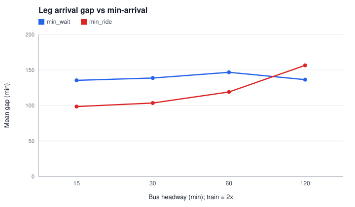
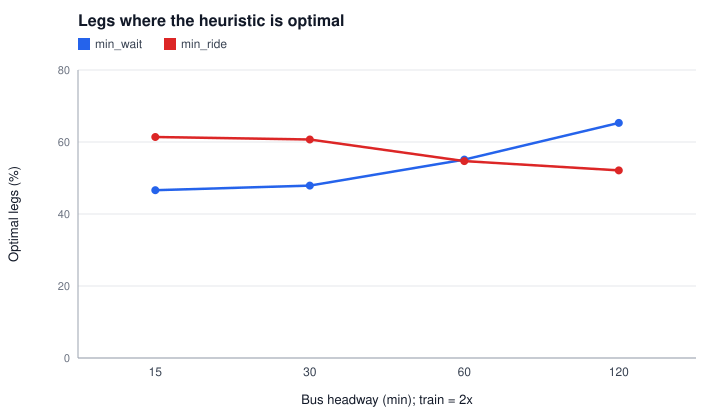
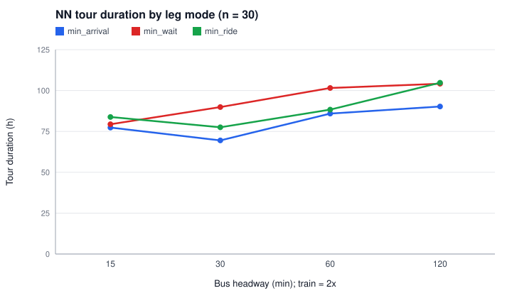

# Experiment 1 - Heuristic gap (RQ1)

How much later do the min-wait and min-ride leg heuristics arrive than min-arrival, and when do they fail? Leg level: random single-leg queries. Tour level: nearest-neighbour tour from the start city using each mode's legs.

> Generated by `tdtsp.experiment.ExperimentMain`; edit `config.properties`, not this file.

## Reproduce

```
mvn -q compile
java -cp target/classes tdtsp.experiment.ExperimentMain exp1_heuristics
```

## Config

```properties
# RQ1 - heuristic gap: min-wait / min-ride vs min-arrival, varying the headway.
cities=30
headways=15,30,60,120
buffer=5
# Random single-leg queries per instance.
queries=200
# Seeds change the generated network (lines, modes) and the random query set.
seeds=1,2,3,4,5
# Train headway = bus headway x this factor (main config: bus 30, train 60).
trainHeadwayFactor=2
# The one-day timetable is repeated for this many days so multi-day tours stay feasible.
days=14
startCity=Kuala Lumpur
# Minutes from 00:00 (08:00).
startTime=480
```

## Outputs

- `results.csv`: one row per headway, seed and mode
- `summary.csv`: mean/median/std over seeds per headway and mode
- `plots/gap_vs_headway.svg`, `plots/optimal_vs_headway.svg`, `plots/tour_vs_headway.svg`

## Results (mean over seeds)

| headway | mode | pct_optimal_mean | mean_gap_min_mean | max_gap_min_mean | mean_wait_min_mean | mean_ride_min_mean | tour_elapsed_h_mean | tour_infeasible_legs_mean |
| --- | --- | --- | --- | --- | --- | --- | --- | --- |
| 15 | min_arrival | 100.000 | 0.000 | 0.000 | 104.971 | 513.644 | 77.333 | 0.000 |
| 15 | min_wait | 46.600 | 135.429 | 1256.200 | 87.586 | 666.458 | 79.373 | 0.000 |
| 15 | min_ride | 61.400 | 98.506 | 1065.200 | 221.400 | 495.721 | 83.807 | 0.000 |
| 30 | min_arrival | 100.000 | 0.000 | 0.000 | 131.530 | 514.969 | 69.487 | 0.000 |
| 30 | min_wait | 47.900 | 138.681 | 1410.000 | 107.186 | 677.994 | 89.870 | 0.000 |
| 30 | min_ride | 60.700 | 103.495 | 1044.600 | 254.273 | 495.721 | 77.510 | 0.000 |
| 60 | min_arrival | 100.000 | 0.000 | 0.000 | 173.384 | 522.360 | 85.907 | 0.000 |
| 60 | min_wait | 55.100 | 146.745 | 1782.000 | 142.534 | 699.955 | 101.570 | 0.000 |
| 60 | min_ride | 54.700 | 119.035 | 1005.200 | 319.058 | 495.721 | 88.313 | 0.000 |
| 120 | min_arrival | 100.000 | 0.000 | 0.000 | 247.089 | 535.165 | 90.220 | 0.000 |
| 120 | min_wait | 65.300 | 136.369 | 1713.600 | 225.579 | 693.044 | 104.160 | 0.000 |
| 120 | min_ride | 52.100 | 156.521 | 1070.400 | 443.054 | 495.721 | 104.787 | 0.000 |








## Notes

- Instances: top-`n` cities by population from `data/processed/cities_all.csv`, network and timetable from `NetworkGenerator` with the base `config.properties`, overriding only the seed, headways and transfer buffer listed above. The train headway is `trainHeadwayFactor` times the bus headway.
- The generated timetable covers one service day (06:00-22:00). It is repeated for `days` consecutive days so that multi-day tours remain feasible; day `d` is shifted by `d * 1440` minutes.
- Runtimes are wall-clock on the machine that ran the experiment and vary between runs; all other values are deterministic for a given config.
- `gap` = heuristic arrival minus earliest arrival for the same query, over queries where min-arrival is feasible. `failed` counts queries where the heuristic found no journey.
- Min-wait and min-ride are label-setting heuristics on (stop, trip) states ordered by waiting or riding time (plan §5.5); they are not exact optimisers of their own cost.
- min_arrival legs use CSA; its waiting/riding columns describe the earliest-arrival journey.

