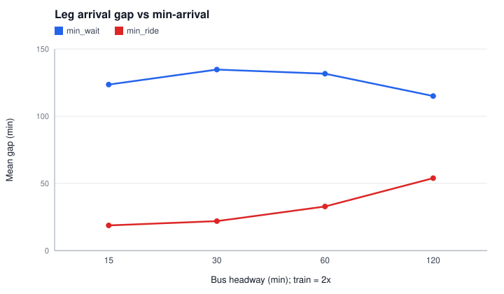
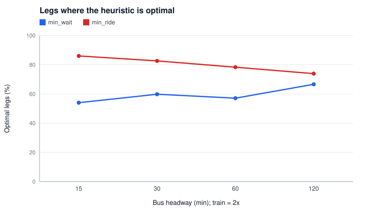
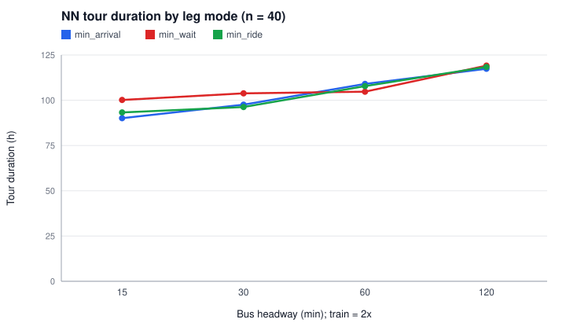

# Experiment 1 - Heuristic gap (RQ1)

How much later do the min-wait and min-ride leg heuristics arrive than min-arrival, and when do they fail? Leg level: random single-leg queries. Tour level: nearest-neighbour tour from the start city using each mode's legs.

> Generated by `tdtsp.experiment.ExperimentMain`; edit `config.properties`, not this file.

## Reproduce

```
mvn -q compile
java -cp target/classes tdtsp.experiment.ExperimentMain exp1_heuristics
```

## Config

```properties
# RQ1 - heuristic gap: min-wait / min-ride vs min-arrival, varying the headway.
cities=40
headways=15,30,60,120
buffer=5
# Random single-leg queries per instance.
queries=200
# Seeds change the generated network (lines, modes) and the random query set.
seeds=1,2,3,4,5
# Train headway = bus headway x this factor (main config: bus 30, train 60).
trainHeadwayFactor=2
# The one-day timetable is repeated for this many days so multi-day tours stay feasible.
days=14
startCity=Kuala Lumpur
# Minutes from 00:00 (08:00).
startTime=480
```

## Outputs

- `results.csv`: one row per headway, seed and mode
- `summary.csv`: mean/median/std over seeds per headway and mode
- `plots/gap_vs_headway.svg`, `plots/optimal_vs_headway.svg`, `plots/tour_vs_headway.svg`

## Results (mean over seeds)

| headway | mode | pct_optimal_mean | mean_gap_min_mean | max_gap_min_mean | mean_wait_min_mean | mean_ride_min_mean | tour_elapsed_h_mean | tour_infeasible_legs_mean |
| --- | --- | --- | --- | --- | --- | --- | --- | --- |
| 15 | min_arrival | 100.000 | 0.000 | 0.000 | 130.294 | 569.392 | 90.093 | 0.000 |
| 15 | min_wait | 54.000 | 123.523 | 1360.000 | 126.414 | 696.795 | 100.190 | 0.000 |
| 15 | min_ride | 86.000 | 18.756 | 560.200 | 162.048 | 556.394 | 93.283 | 0.000 |
| 30 | min_arrival | 100.000 | 0.000 | 0.000 | 152.866 | 571.083 | 97.583 | 0.000 |
| 30 | min_wait | 59.800 | 134.685 | 1524.000 | 150.899 | 707.735 | 103.813 | 0.000 |
| 30 | min_ride | 82.600 | 21.938 | 516.000 | 189.493 | 556.394 | 96.263 | 0.000 |
| 60 | min_arrival | 100.000 | 0.000 | 0.000 | 201.220 | 579.030 | 109.040 | 0.000 |
| 60 | min_wait | 57.100 | 131.609 | 1458.000 | 190.023 | 721.836 | 104.750 | 0.000 |
| 60 | min_ride | 78.300 | 32.827 | 533.800 | 256.683 | 556.394 | 107.803 | 0.000 |
| 120 | min_arrival | 100.000 | 0.000 | 0.000 | 281.173 | 588.416 | 117.383 | 0.000 |
| 120 | min_wait | 66.600 | 115.019 | 1419.200 | 259.876 | 724.732 | 119.137 | 0.000 |
| 120 | min_ride | 73.900 | 53.926 | 693.400 | 367.121 | 556.394 | 118.393 | 0.000 |








## Notes

- Instances: top-`n` cities by population from `data/processed/cities_all.csv`, network and timetable from `NetworkGenerator` with the base `config.properties`, overriding only the seed, headways and transfer buffer listed above. The train headway is `trainHeadwayFactor` times the bus headway.
- The generated timetable covers one service day (06:00-22:00). It is repeated for `days` consecutive days so that multi-day tours remain feasible; day `d` is shifted by `d * 1440` minutes.
- Runtimes are wall-clock on the machine that ran the experiment and vary between runs; all other values are deterministic for a given config.
- `gap` = heuristic arrival minus earliest arrival for the same query, over queries where min-arrival is feasible. `failed` counts queries where the heuristic found no journey.
- Min-wait and min-ride are label-setting heuristics on (stop, trip) states ordered by waiting or riding time (plan §5.5); they are not exact optimisers of their own cost.
- min_arrival legs use CSA; its waiting/riding columns describe the earliest-arrival journey.

### Seed substitutions

- cities=40, headway=15/30, buffer=5: seed 2 failed in the generator, network seed 1002 used
- cities=40, headway=30/60, buffer=5: seed 2 failed in the generator, network seed 1002 used
- cities=40, headway=60/120, buffer=5: seed 2 failed in the generator, network seed 1002 used
- cities=40, headway=120/240, buffer=5: seed 2 failed in the generator, network seed 1002 used

