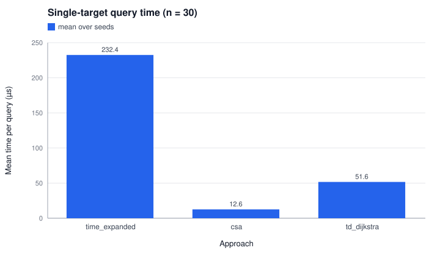
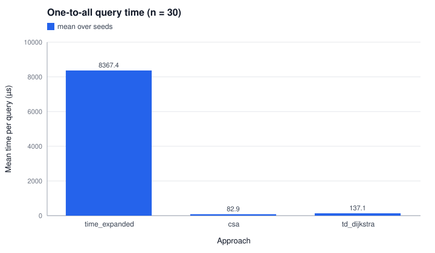
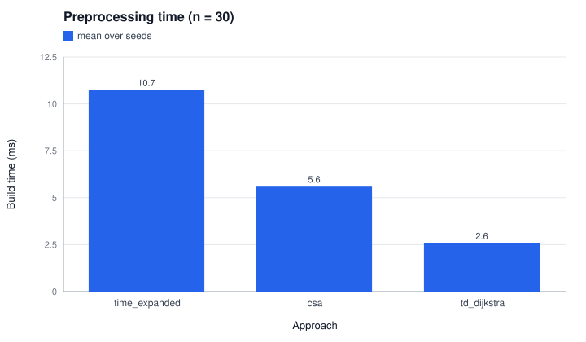
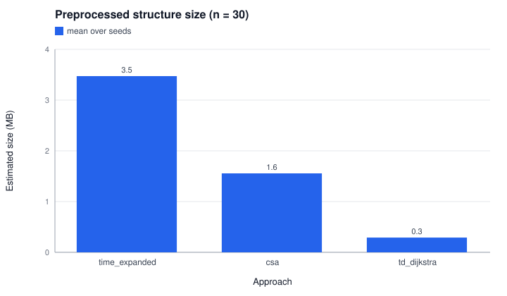

# Experiment 2 - Representation trade-off (RQ2)

How do time-expanded graph + Dijkstra (Approach A) and time-dependent graph + CSA (Approach B) compare in query time, preprocessing time and memory on the main configuration? Time-dependent Dijkstra is included as a third reference point.

> Generated by `tdtsp.experiment.ExperimentMain`; edit `config.properties`, not this file.

## Reproduce

```
mvn -q compile
java -cp target/classes tdtsp.experiment.ExperimentMain exp2_representations
```

## Config

```properties
# RQ2 - representation trade-off at the main configuration.
cities=30
headway=30
buffer=5
queries=200
# Seeds change the generated network (lines, modes) and the random query set.
seeds=1,2,3,4,5
# Train headway = bus headway x this factor (main config: bus 30, train 60).
trainHeadwayFactor=2
# The one-day timetable is repeated for this many days so multi-day tours stay feasible.
days=14
startCity=Kuala Lumpur
# Minutes from 00:00 (08:00).
startTime=480
```

## Outputs

- `results.csv`: one row per seed and approach
- `summary.csv`: mean/median/std over seeds per approach
- `plots/query_time.svg`, `plots/one_to_all_time.svg`, `plots/preprocessing.svg`, `plots/memory.svg`

## Results (mean over seeds)

| approach | prep_ms_mean | query_us_mean | query_us_std | one_to_all_us_mean | structure_mb_mean | timetable_elements_mean | graph_nodes_mean | graph_arcs_mean | mismatches_mean |
| --- | --- | --- | --- | --- | --- | --- | --- | --- | --- |
| td_dijkstra | 2.568 | 51.615 | 14.501 | 137.116 | 0.290 | 37055.200 | 30.000 | 99.600 | 0.000 |
| csa | 5.588 | 12.613 | 8.372 | 82.857 | 1.555 | 37055.200 | 30.000 | 37055.200 | 0.000 |
| time_expanded | 10.735 | 232.435 | 79.303 | 8367.358 | 3.472 | 37055.200 | 111165.600 | 177010.800 | 0.000 |










## Notes

- Instances: top-`n` cities by population from `data/processed/cities_all.csv`, network and timetable from `NetworkGenerator` with the base `config.properties`, overriding only the seed, headways and transfer buffer listed above. The train headway is `trainHeadwayFactor` times the bus headway.
- The generated timetable covers one service day (06:00-22:00). It is repeated for `days` consecutive days so that multi-day tours remain feasible; day `d` is shifted by `d * 1440` minutes.
- Runtimes are wall-clock on the machine that ran the experiment and vary between runs; all other values are deterministic for a given config.
- `query_us`: single-target earliest-arrival query with early termination (what the tour layer uses). `one_to_all_us`: earliest arrival at every stop from one source.
- `prep_ms`: building the structure from the loaded timetable (TD: adjacency list with sorted departure arrays; CSA: sorting connections; TE: event graph). Median of 3 builds after a warm-up build.
- `structure_mb` is estimated from array lengths and JVM object sizes of the preprocessed structure, not measured peak heap, which is too noisy under garbage collection.
- `graph_nodes`/`graph_arcs`: stops/line segments (TD), stops/connections (CSA), events/event arcs (TE). `mismatches`: queries whose arrival differs from CSA (expected 0).

