# Experiment 3 - Scalability (RQ3)

How do time-expanded + Dijkstra, CSA and time-dependent Dijkstra scale with the number of cities, the headway and the transfer buffer? Each factor is varied on its own while the others stay at the main configuration (cities = 30, headway = 30, buffer = 5).

> Generated by `tdtsp.experiment.ExperimentMain`; edit `config.properties`, not this file.

## Reproduce

```
mvn -q compile
java -cp target/classes tdtsp.experiment.ExperimentMain exp3_scalability
```

## Config

```properties
# RQ3 - scalability: one factor varied at a time around the base configuration.
cities=10,20,30,40
headways=15,30,60,120
buffers=0,5,10
baseCities=30
baseHeadway=30
baseBuffer=5
queries=100
# Max passes of 2-opt + insertion over the nearest-neighbour tour.
localSearchPasses=3
# Seeds change the generated network (lines, modes) and the random query set.
seeds=1,2,3,4,5
# Train headway = bus headway x this factor (main config: bus 30, train 60).
trainHeadwayFactor=2
# The one-day timetable is repeated for this many days so multi-day tours stay feasible.
days=14
startCity=Kuala Lumpur
# Minutes from 00:00 (08:00).
startTime=480
```

## Outputs

- `results.csv`: one row per factor value, seed and approach
- `tours.csv`: tour duration per factor value and seed (CSA legs)
- `summary.csv`, `tours_summary.csv`: mean/median/std over seeds
- `plots/`: query time, preprocessing, memory and tour duration against each factor

## Results (mean over seeds)

### Routing

| factor | value | approach | prep_ms_mean | query_us_mean | structure_mb_mean | timetable_elements_mean | graph_nodes_mean | graph_arcs_mean |
| --- | --- | --- | --- | --- | --- | --- | --- | --- |
| cities | 10 | td_dijkstra | 0.958 | 37.249 | 0.232 | 29680.000 | 10.000 | 84.800 |
| cities | 10 | csa | 2.313 | 5.642 | 1.245 | 29680.000 | 10.000 | 29680.000 |
| cities | 10 | time_expanded | 7.355 | 179.212 | 2.776 | 29680.000 | 89040.000 | 141163.000 |
| cities | 20 | td_dijkstra | 1.083 | 39.401 | 0.232 | 29685.600 | 20.000 | 85.200 |
| cities | 20 | csa | 2.093 | 6.746 | 1.246 | 29685.600 | 20.000 | 29685.600 |
| cities | 20 | time_expanded | 5.420 | 165.082 | 2.776 | 29685.600 | 89056.800 | 141166.200 |
| cities | 30 | td_dijkstra | 1.413 | 53.798 | 0.290 | 37055.200 | 30.000 | 99.600 |
| cities | 30 | csa | 2.797 | 8.883 | 1.555 | 37055.200 | 30.000 | 37055.200 |
| cities | 30 | time_expanded | 6.377 | 206.935 | 3.472 | 37055.200 | 111165.600 | 177010.800 |
| cities | 40 | td_dijkstra | 1.738 | 57.495 | 0.357 | 45707.200 | 40.000 | 116.000 |
| cities | 40 | csa | 3.375 | 11.173 | 1.918 | 45707.200 | 40.000 | 45707.200 |
| cities | 40 | time_expanded | 8.003 | 244.947 | 4.289 | 45707.200 | 137121.600 | 219147.400 |
| headway | 15 | td_dijkstra | 2.670 | 79.567 | 0.562 | 72716.000 | 30.000 | 99.600 |
| headway | 15 | csa | 5.697 | 24.549 | 3.051 | 72716.000 | 30.000 | 72716.000 |
| headway | 15 | time_expanded | 15.464 | 422.247 | 6.812 | 72716.000 | 218148.000 | 347415.200 |
| headway | 30 | td_dijkstra | 1.413 | 53.798 | 0.290 | 37055.200 | 30.000 | 99.600 |
| headway | 30 | csa | 2.797 | 8.883 | 1.555 | 37055.200 | 30.000 | 37055.200 |
| headway | 30 | time_expanded | 6.377 | 206.935 | 3.472 | 37055.200 | 111165.600 | 177010.800 |
| headway | 60 | td_dijkstra | 0.760 | 37.919 | 0.154 | 19224.800 | 30.000 | 99.600 |
| headway | 60 | csa | 1.222 | 5.232 | 0.807 | 19224.800 | 30.000 | 19224.800 |
| headway | 60 | time_expanded | 3.035 | 106.860 | 1.801 | 19224.800 | 57674.400 | 91808.400 |
| headway | 120 | td_dijkstra | 0.382 | 27.014 | 0.086 | 10309.600 | 30.000 | 99.600 |
| headway | 120 | csa | 0.567 | 2.661 | 0.433 | 10309.600 | 30.000 | 10309.600 |
| headway | 120 | time_expanded | 1.517 | 52.423 | 0.966 | 10309.600 | 30928.800 | 49206.400 |
| buffer | 0 | td_dijkstra | 1.567 | 47.741 | 0.290 | 37055.200 | 30.000 | 99.600 |
| buffer | 0 | csa | 2.787 | 8.609 | 1.555 | 37055.200 | 30.000 | 37055.200 |
| buffer | 0 | time_expanded | 6.497 | 195.757 | 3.472 | 37055.200 | 111165.600 | 177036.600 |
| buffer | 5 | td_dijkstra | 1.413 | 53.798 | 0.290 | 37055.200 | 30.000 | 99.600 |
| buffer | 5 | csa | 2.797 | 8.883 | 1.555 | 37055.200 | 30.000 | 37055.200 |
| buffer | 5 | time_expanded | 6.377 | 206.935 | 3.472 | 37055.200 | 111165.600 | 177010.800 |
| buffer | 10 | td_dijkstra | 1.473 | 52.442 | 0.290 | 37055.200 | 30.000 | 99.600 |
| buffer | 10 | csa | 2.920 | 8.797 | 1.555 | 37055.200 | 30.000 | 37055.200 |
| buffer | 10 | time_expanded | 6.584 | 208.006 | 3.472 | 37055.200 | 111165.600 | 177008.000 |

### Tours

| factor | value | nn_elapsed_h_mean | ls_elapsed_h_mean | nn_infeasible_legs_mean | ls_infeasible_legs_mean | ls_ms_mean |
| --- | --- | --- | --- | --- | --- | --- |
| cities | 10 | 17.433 | 14.383 | 0.000 | 0.000 | 1.349 |
| cities | 20 | 65.903 | 61.853 | 0.000 | 0.000 | 9.710 |
| cities | 30 | 69.487 | 62.687 | 0.000 | 0.000 | 23.767 |
| cities | 40 | 97.583 | 79.440 | 0.000 | 0.000 | 54.381 |
| headway | 15 | 77.333 | 61.060 | 0.000 | 0.000 | 57.658 |
| headway | 30 | 69.487 | 62.687 | 0.000 | 0.000 | 23.767 |
| headway | 60 | 85.907 | 64.407 | 0.000 | 0.000 | 14.567 |
| headway | 120 | 90.220 | 81.093 | 0.000 | 0.000 | 7.971 |
| buffer | 0 | 69.487 | 62.687 | 0.000 | 0.000 | 24.574 |
| buffer | 5 | 69.487 | 62.687 | 0.000 | 0.000 | 23.767 |
| buffer | 10 | 70.000 | 62.400 | 0.000 | 0.000 | 22.832 |

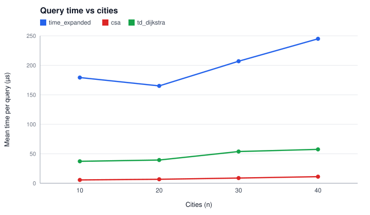

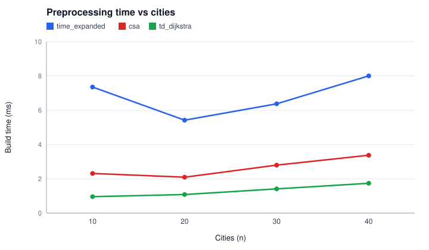

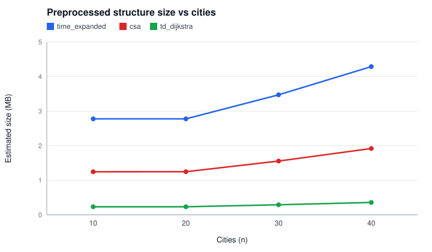

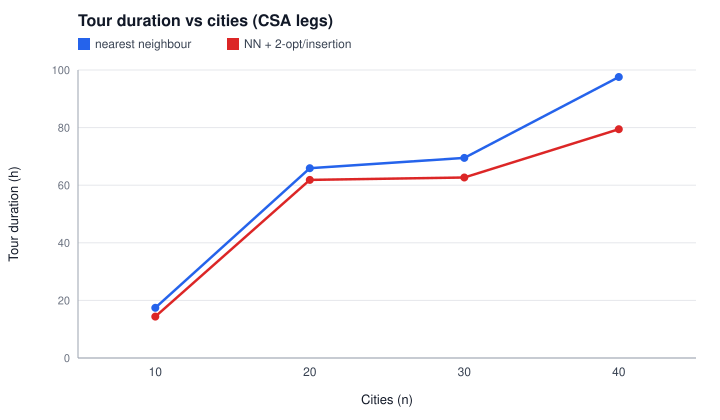

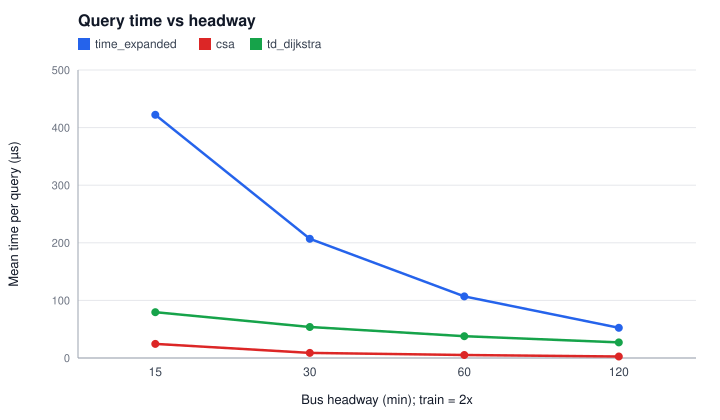

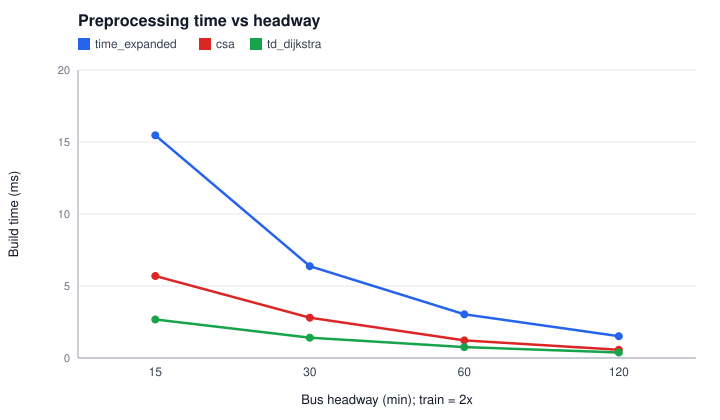

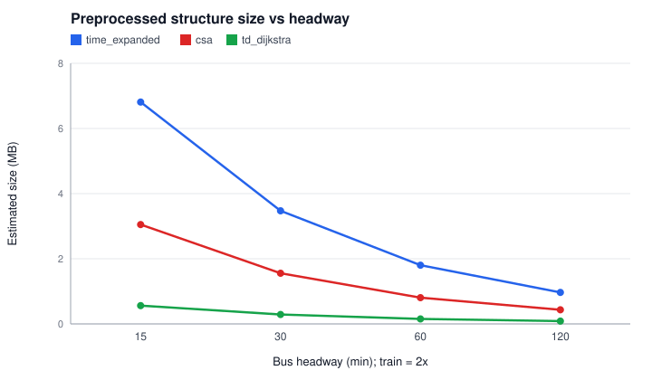

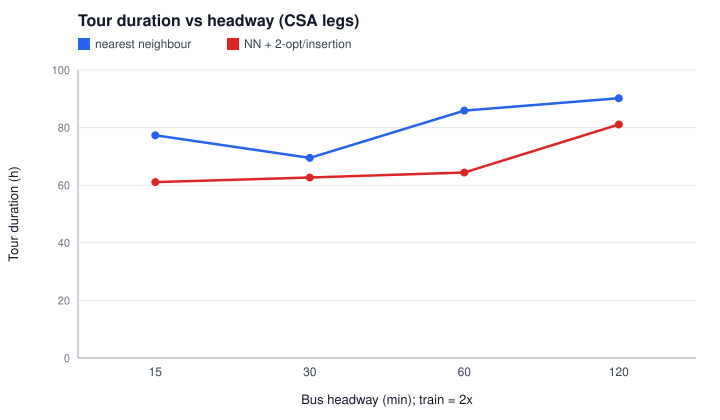

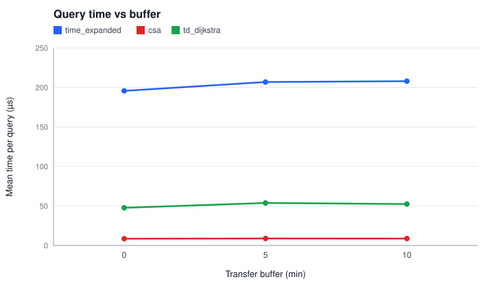

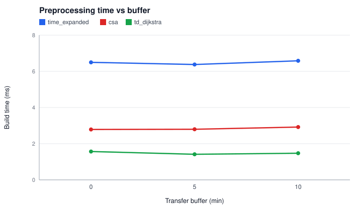

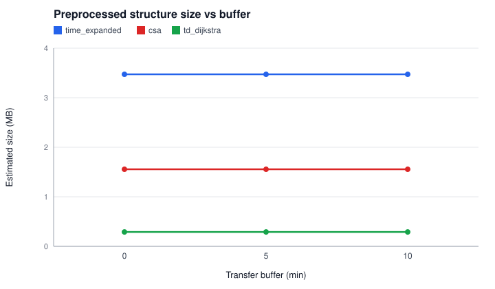

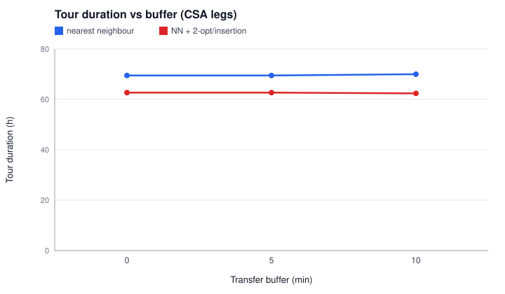


## Notes

- Instances: top-`n` cities by population from `data/processed/cities_all.csv`, network and timetable from `NetworkGenerator` with the base `config.properties`, overriding only the seed, headways and transfer buffer listed above. The train headway is `trainHeadwayFactor` times the bus headway.
- The generated timetable covers one service day (06:00-22:00). It is repeated for `days` consecutive days so that multi-day tours remain feasible; day `d` is shifted by `d * 1440` minutes.
- Runtimes are wall-clock on the machine that ran the experiment and vary between runs; all other values are deterministic for a given config.
- Query time, preprocessing and memory are measured as in Experiment 2.
- Tours start at the start city at the start time; nearest neighbour, then 2-opt and insertion with full re-evaluation for at most `localSearchPasses` passes. `ls_ms` is the local-search time.

### Seed substitutions

- cities=40, headway=30/60, buffer=5: seed 2 failed in the generator, network seed 1002 used

