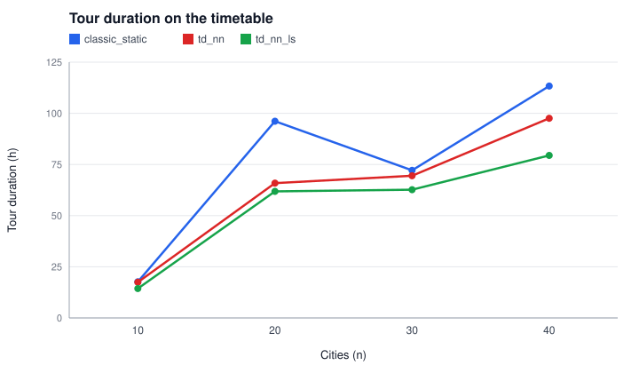
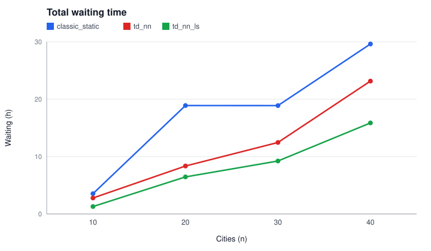
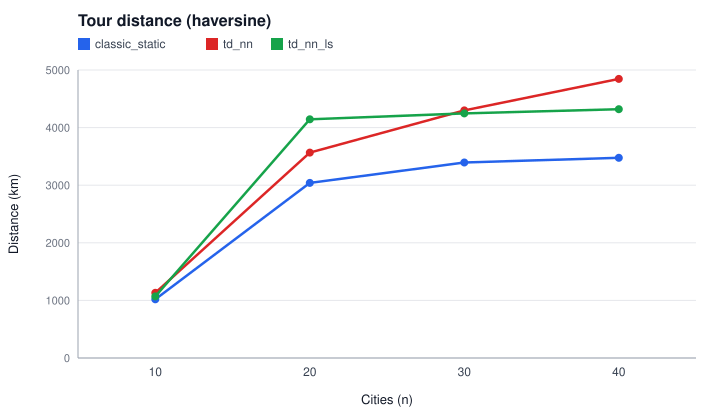

# Experiment 4 - Classic baseline (RQ4)

How does the classic static TSP tour (nearest neighbour + 2-opt on haversine distance, ignoring the timetable) perform when it is actually travelled on the timetable, compared with the time-dependent tours?

> Generated by `tdtsp.experiment.ExperimentMain`; edit `config.properties`, not this file.

## Reproduce

```
mvn -q compile
java -cp target/classes tdtsp.experiment.ExperimentMain exp4_classic_baseline
```

## Config

```properties
# RQ4 - classic static TSP tour vs time-dependent tours, travelled on the timetable.
cities=10,20,30,40
headway=30
buffer=5
localSearchPasses=3
# Seeds change the generated network (lines, modes) and the random query set.
seeds=1,2,3,4,5
# Train headway = bus headway x this factor (main config: bus 30, train 60).
trainHeadwayFactor=2
# The one-day timetable is repeated for this many days so multi-day tours stay feasible.
days=14
startCity=Kuala Lumpur
# Minutes from 00:00 (08:00).
startTime=480
```

## Outputs

- `results.csv`: one row per city count, seed and method
- `summary.csv`: mean/median/std over seeds per city count and method
- `plots/elapsed_vs_cities.svg`, `plots/waiting_vs_cities.svg`, `plots/distance_vs_cities.svg`

## Results (mean over seeds)

| cities | method | elapsed_h_mean | elapsed_h_std | waiting_h_mean | ride_h_mean | transfers_mean | infeasible_legs_mean | distance_km_mean | build_ms_mean |
| --- | --- | --- | --- | --- | --- | --- | --- | --- | --- |
| 10 | classic_static | 17.657 | 3.681 | 3.533 | 14.123 | 1.600 | 0.000 | 1018.994 | 2.770 |
| 10 | td_nn | 17.433 | 3.789 | 2.780 | 14.653 | 1.200 | 0.000 | 1131.843 | 4.249 |
| 10 | td_nn_ls | 14.383 | 1.914 | 1.293 | 13.090 | 1.200 | 0.000 | 1069.691 | 9.227 |
| 20 | classic_static | 96.120 | 33.522 | 18.897 | 77.223 | 8.200 | 0.000 | 3039.782 | 0.086 |
| 20 | td_nn | 65.903 | 12.368 | 8.357 | 57.547 | 4.200 | 0.000 | 3566.344 | 1.748 |
| 20 | td_nn_ls | 61.853 | 11.159 | 6.457 | 55.397 | 4.000 | 0.000 | 4144.516 | 19.489 |
| 30 | classic_static | 72.117 | 13.818 | 18.887 | 53.230 | 10.400 | 0.000 | 3393.854 | 0.274 |
| 30 | td_nn | 69.487 | 6.503 | 12.457 | 57.030 | 4.800 | 0.000 | 4298.196 | 2.774 |
| 30 | td_nn_ls | 62.687 | 11.257 | 9.233 | 53.453 | 4.800 | 0.000 | 4245.735 | 33.647 |
| 40 | classic_static | 113.310 | 35.700 | 29.627 | 83.683 | 13.200 | 0.000 | 3475.314 | 0.642 |
| 40 | td_nn | 97.583 | 20.254 | 23.153 | 74.430 | 10.400 | 0.000 | 4846.195 | 8.938 |
| 40 | td_nn_ls | 79.440 | 13.064 | 15.867 | 63.573 | 9.000 | 0.000 | 4318.688 | 90.738 |








## Notes

- Instances: top-`n` cities by population from `data/processed/cities_all.csv`, network and timetable from `NetworkGenerator` with the base `config.properties`, overriding only the seed, headways and transfer buffer listed above. The train headway is `trainHeadwayFactor` times the bus headway.
- The generated timetable covers one service day (06:00-22:00). It is repeated for `days` consecutive days so that multi-day tours remain feasible; day `d` is shifted by `d * 1440` minutes.
- Runtimes are wall-clock on the machine that ran the experiment and vary between runs; all other values are deterministic for a given config.
- Methods: `classic_static` = static NN + 2-opt on the complete haversine graph, then evaluated leg by leg with earliest-arrival routing (CSA); `td_nn` = time-dependent nearest neighbour; `td_nn_ls` = `td_nn` followed by 2-opt and insertion with full re-evaluation.
- All tours start at the start city at the start time; the duration is the final arrival minus the start time. Infeasible legs are counted and skipped (plan §5.6).
- `build_ms` is the time to construct the tour (for `classic_static`, without the timetable evaluation).

### Seed substitutions

- cities=40, headway=30/60, buffer=5: seed 2 failed in the generator, network seed 1002 used

